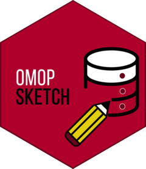
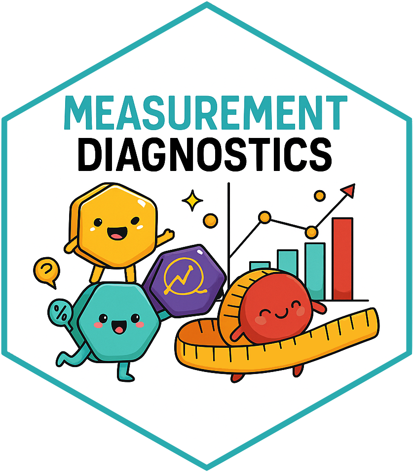

```{r, echo=FALSE, message=FALSE}
options(timeout = 3600) # aixo faria un timeout de una hora, no crec que trigui mes
```

## Introduction

<br>

Creating cohorts from scratch using R. Workflow overview:

<br>

::::::::::: columns
:::: {.column .fragment width="25%"}
### 1. Codelists

Creating codelists

::: text-center
**↓**

[`CodelistGenerator`](https://github.com/darwin-eu/CodelistGenerator)
:::
::::

::: {.column .fragment .arrow-column width="6%"}
<br> **→**
:::

:::: {.column .fragment width="25%"}
### 2. Cohorts

Codelists + cohort logic

::: text-center
**↓**

[`CohortConstructor`](https://github.com/OHDSI/CohortConstructor)
:::
::::

::: {.column .fragment .arrow-column width="6%"}
<br> **→**
:::

:::: {.column .fragment width="37%"}
### 3. Review

Reviewing codelists and cohorts

::: text-center
**↓**

[`PhenotypeR`](https://github.com/OHDSI/PhenotypeR)
:::
::::
:::::::::::

<br>

::: {.callout-note .fragment}
All three packages are **open source and available on CRAN**.
:::

## What are we going to build?

<br>

:::::: columns
::: {.column .fragment width="47%"}
### Primary (essential) hypertension

**Condition-based phenotype**

1.  Start with hypertension codelist
2.  Create initial base cohort
3.  Require **≥ 180 days prior observation**
4.  Restrict to **adults (≥ 18 years)**
5.  Require a **second hypertension record** within 365 days
6.  Exit at **end of observation**
:::

::: {.column width="6%"}
:::

::: {.column .fragment width="47%"}
### Warfarin users

**Drug-based phenotype**

1.  Start with warfarin codelist
2.  Create initial exposure cohort
3.  Collapse exposures with a **≤ 30-day gap**
4.  Require **≥ 365 days prior observation**
5.  Require **365-day washout**
:::
::::::

# Step 1: Creating codelists

## CodelistGenerator

<br>

The [`CodelistGenerator`](https://github.com/darwin-eu/CodelistGenerator) R package provides tools to

<br>

::: incremental
-   **Explore OMOP CDM vocabularies** available in the database

-   **Generate codelists systematically** using vocabulary-based search strategies

-   **Generate codelist diagnostics** to assess code use and identify potentially missing concepts
:::

<br>

## Generating candidate concepts

\linespace{5mm}

Today, we'll focus on the `getCandidateCodes()` function to identify candidate concepts for our two phenotypes.

\linespace{5mm}

::: incremental
```{r, eval=FALSE}
getCandidateCodes(
  cdm,
  keywords,
  exclude = NULL,
  domains = "Condition",
  vocabularyId = NULL,
  standardConcept = "Standard",
  searchInSynonyms = FALSE,
  searchNonStandard = FALSE,
  includeDescendants = TRUE,
  includeAncestor = FALSE
)
```
:::

\linespace{5mm}

. . .

The function returns **candidate concepts for review**, together with the **search strategy** used to identify them.

This allows us to define a **systematic and reproducible codelist search strategy**.

## Create CDM reference

1)  Load relevant packages

. . .

```{r, message=FALSE}
library(omock)
library(CodelistGenerator)
library(CohortConstructor)
library(PhenotypeR)
library(omopgenerics)
library(here)
library(duckdb)
library(visOmopResults)
library(gt)
```

2)  Create a cdm reference to a synthetic omop database

. . .

```{r, message=FALSE}
cdm <- mockCdmFromDataset(datasetName = "synpuf-1k_5.4", source = "duckdb")
```

## Create CDM reference

<br>

The `cdm` object provides a reference to the tables in our data source.

We can access individual tables using `$`. For example, to access the OMOP `person` table:

```{r, message=TRUE}
cdm$person
```

# Let's create our codelists

## Primary hypertension codelist

### Generate candidate concepts

Our target phenotype is **primary (essential) hypertension**.

We start by searching for concepts related to `"essential hypertension"`:

```{r, message=FALSE}
hypertensionCodes <- getCandidateCodes(
  cdm = cdm,
  keywords = "essential hypertension",
  domains = "condition",
  standardConcept = "Standard",
  searchInSynonyms = TRUE,
  includeDescendants = TRUE
)
hypertensionCodes
```

## Primary hypertension codelist

Do all candidate concepts represent the phenotype we want?

. . .

Some candidate concepts represent **essential hypertension in an obstetric context**:

```{r, message=FALSE, echo=FALSE}
hypertensionCodes$concept_name 
```

## Primary hypertension codelist

If we identify unwanted candidate concepts that can be **systematically captured by keywords**, we can refine our search strategy using exclusion terms:

::: fragment
```{r, message=FALSE}
hypertensionCodes <- getCandidateCodes(
  cdm = cdm,
  keywords = "essential hypertension",
  exclude = c("pregnancy", "childbirth", "puerperium", "obstetric", "postpartum", "postnatal"),
  domains = "condition",
  standardConcept = "Standard",
  searchInSynonyms = TRUE,
  includeDescendants = TRUE
)
hypertensionCodes
```
:::

## Primary hypertension codelist

::: {.callout-note .fragment}
A refined search strategy does **not** mean we have a final codelist.

`CodelistGenerator` helps us define a **reproducible search strategy** and generate a **preliminary codelist**.

Before cohort construction, this preliminary codelist is **clinically reviewed**.

Once cohorts are created, **diagnostics provide further evidence to support additional codelist review and refinement**.
:::

## Warfarin codelist

### Generate candidate concepts

We repeat the process for **warfarin**, starting with an initial search strategy:

```{r, message=FALSE}
warfarinCodes <- getCandidateCodes(
  cdm = cdm,
  keywords = "warfarin",
  domains = "drug",
  standardConcept = "Standard",
  searchInSynonyms = TRUE,
  includeDescendants = TRUE
)

warfarinCodes
```

# Step 2: Constructing cohorts

## CohortConstructor

<br>

[`CohortConstructor`](https://github.com/OHDSI/CohortConstructor) provides tools to create and manipulate cohorts using the OMOP CDM.

::: incremental
-   Create **base cohorts** from codelists
-   Apply **demographic and observation requirements**
-   Apply **additional clinical requirements**
-   Define **cohort entry and exit**
-   **Combine, collapse, and manipulate** cohort records
:::

## Primary hypertension cohort

<br>

We will progressively apply our cohort inclusion criteria to identify adults with **primary (essential) hypertension**.

::: incremental
1.  Create a base cohort from our essential hypertension codelist
2.  Require **≥ 180 days of prior observation**
3.  Restrict to **age ≥ 18 years**
4.  Require a **second hypertension record within 365 days**
5.  Exit at **end of observation**
:::

## Primary hypertension cohort

### → Create the base cohort

We first create a base cohort from condition records corresponding to concepts in our preliminary hypertension codelist:

```{r}
hypertensionCodelist <- list("essential_hypertension" = hypertensionCodes$concept_id)

cdm$essential_hypertension_base <- conceptCohort(
  cdm = cdm,
  conceptSet = hypertensionCodelist,
  name = "essential_hypertension_base"
)
```

::: fragment
At this stage, each qualifying hypertension record can contribute to cohort entry.

```{r, echo=FALSE}
CohortCharacteristics::summariseCohortAttrition(
  cdm$essential_hypertension_base
) |>
  CohortCharacteristics::tableCohortAttrition()
```
:::

## Primary hypertension cohort

### → Apply the inclusion criteria

Now we apply inclusion criteria in a pipeline-fashion to refine the base cohort:

```{r}
cdm$essential_hypertension <- cdm$essential_hypertension_base |>

  # Age ≥18 and ≥180 days of prior observation
  requireDemographics(
    ageRange = c(18, 150),
    minPriorObservation = 180,
    name = "essential_hypertension"
  ) |>

  # Require another hypertension record within 365 days
  requireCohortIntersect(
    targetCohortTable = "essential_hypertension_base",
    window = c(1, 365),
    intersections = c(1, Inf),
    name = "essential_hypertension"
  ) |>

  # Follow until the end of observation
  exitAtObservationEnd(
    name = "essential_hypertension"
  )
```

## Primary hypertension cohort

### Cohort attrition

How does each requirement affect the number of people meeting our phenotype definition?

```{r, echo=FALSE}
CohortCharacteristics::summariseCohortAttrition(
  cdm$essential_hypertension
) |>
  CohortCharacteristics::tableCohortAttrition()
```

## More complex phenotype definitions

Our primary hypertension cohort was a **simple example** to illustrate the workflow.

We can also implement more complex phenotype definitions combining different types of clinical evidence.

::: fragment
For instance we could use systolic and diastolic blood pressure measurements:

```{r, eval=FALSE}
cdm$systolic_blood_pressure <- measurementCohort(
  cdm = cdm, 
  conceptSet = codelist["systolic_blood_pressure"],
  valueAsNumber = list(c(140, 99999)),
  name = "systolic_blood_pressure"
)

cdm$diastolic_blood_pressure <- measurementCohort(
  cdm = cdm, 
  conceptSet = codelist["diastolic_blood_pressure"],
  valueAsNumber = list(c(90, 99999)),
  name = "diastolic_blood_pressure"
)
```
:::

## Warfarin cohort

<br>

We want to identify **new users of warfarin**.

::: incremental
1.  Create a base cohort from our warfarin codelist
2.  Collapse exposures separated by **≤ 30 days**
3.  Require **≥ 365 days of prior observation**
4.  Require **no warfarin exposure in the previous 365 days**
:::

## Warfarin cohort

### → Create the base cohort

We first create a base cohort from drug exposure records corresponding to concepts in our **preliminary warfarin codelist**:

```{r}
warfarinCodelist <- list("warfarin" = warfarinCodes$concept_id)

cdm$warfarin_base <- conceptCohort(
  cdm = cdm,
  conceptSet = warfarinCodelist,
  name = "warfarin_base"
)
```

::: fragment
At this stage, qualifying warfarin exposures can contribute to cohort entries.

```{r, echo=FALSE}
CohortCharacteristics::summariseCohortAttrition(
  cdm$warfarin_base
) |>
  CohortCharacteristics::tableCohortAttrition()
```
:::

## Warfarin cohort

### → Create treatment episodes and identify new users

We now combine nearby exposures into treatment episodes and apply our new-user criteria:

```{r}
cdm$warfarin_new_users <- cdm$warfarin_base |>

  # Collapse exposures separated by ≤30 days
  collapseCohorts(
    gap = 30,
    name = "warfarin_new_users"
  ) |>

  # Require ≥365 days of prior observation
  requireDemographics(
    minPriorObservation = 365,
    name = "warfarin_new_users"
  ) |>

  # No warfarin exposure during the previous 365 days
  requireCohortIntersect(
    targetCohortTable = "warfarin_base",
    window = c(-365, -1),
    intersections = 0,
    name = "warfarin_new_users"
  )
```

## Warfarin cohort

### New-user cohort attrition

How do our requirements affect the number of warfarin treatment episodes?

```{r, echo=FALSE}
CohortCharacteristics::summariseCohortAttrition(cdm$warfarin_new_users) |>
  CohortCharacteristics::tableCohortAttrition()
```

# Step 3: Reviewing cohorts

## PhenotypeR

[`PhenotypeR`](https://ohdsi.github.io/PhenotypeR/) provides a standardised set of diagnostics to **review and evaluate phenotypes** created using the OMOP CDM.

::: {style="margin-bottom: 10px;"}
:::

::::::: columns
:::: {.column width="45%"}
-   **Database diagnostics**

    -   `databaseDiagnostics()`

::: {style="margin-bottom: 10px;"}
:::

-   **Codelist diagnostics**

    -   `codelistDiagnostics()`
::::

:::: {.column width="55%"}
-   **Cohort diagnostics**

    -   `cohortDiagnostics()`

::: {style="margin-bottom: 10px;"}
:::

-   **Population diagnostics**

    -   `populationDiagnostics()`
::::
:::::::

## Database Diagnostics

Summarise the database metadata including:

1.  **Snapshot**
2.  Summary of the **person table**
3.  Summary of the **observation period**
4.  Summary of the **clinical tables** (e.g., *condition_occurrence*) where concepts from the codelists defining the cohorts are found.

<br>

::::::: {.callout-note .fragment}
:::::: columns
:::: {.column width="15%"}
::: text-center
{width="120"}
:::
::::

::: {.column width="85%"}
Database diagnostics use functionality from [`OmopSketch`](https://ohdsi.github.io/OmopSketch/).
:::
::::::
:::::::

## Codelist Diagnostics

-   Summarise the codelist associated with your cohort including:
    1.  **Achilles codes use** (only if ACHILLES tables are present)
    2.  **Orphan codes use** (only if ACHILLES tables are present)
    3.  **Cohort code use**
    4.  **Measurement code use** (only if measurement concepts are present in your codelist)
    5.  **Drug diagnostics** (only if drug concepts are present in your codelist)

::::::: {.callout-note .fragment}
:::::: columns
:::: {.column width="20%"}
::: text-center
{width="105"} {width="105"}
:::
::::

::: {.column width="80%"}
Codelist diagnostics use functionality from [`CodelistGenerator`](https://darwin-eu.github.io/CodelistGenerator/) to **evaluate the use of concepts from our codelists in the OMOP CDM**.

If the codelists contain measurement concepts, [`MeasurementDiagnostics`](https://darwin-eu.github.io/MeasurementDiagnostics/) is used to **evaluate those concepts**.
:::
::::::
:::::::

## Cohort Diagnostics

## Cohort Diagnostics

Summarise and evaluate the cohorts including:

1.  **Cohort count & attrition**
2.  **Cohort characteristics** — Baseline characteristics of the cohort
3.  **Large-scale characteristics** — Clinical records observed in different time windows
4.  **Compare cohorts** — Overlap and timing between cohorts *(if multiple cohorts)*
5.  **Cohort survival** — Survival until death *(if death table is available)*

<br>

::::::: {.callout-note .fragment}
:::::: columns
:::: {.column width="20%"}
::: text-center
{width="105"} {width="105"}
:::
::::

::: {.column width="80%"}
Cohort diagnostics use functionality from [`CohortCharacteristics`](https://darwin-eu.github.io/CohortCharacteristics/) to **characterise and compare cohorts**, and [`CohortSurvival`](https://darwin-eu.github.io/CohortSurvival/) to **perform survival analyses**.
:::
::::::
:::::::

## Population Diagnostics

-   Contextualises the frequency of your study cohorts in the database calculating:
    1.  **Incidence**
    2.  **Period Prevalence**

::::::: {.callout-note .fragment}
:::::: columns
:::: {.column width="15%"}
::: text-center
{width="120"}
:::
::::

::: {.column width="85%"}
Population diagnostics use functionality from [`IncidencePrevalence`](https://darwin-eu.github.io/IncidencePrevalence/) to **estimate the incidence and prevalence of our cohorts in the database population**.
:::
::::::
:::::::

## Run diagnostics together

Rather than running each diagnostic separately, `phenotypeDiagnostics()` allows us to run them **together**.

```{r, eval=FALSE}
result <- phenotypeDiagnostics(
  cohort,
  databaseDiagnostics = list(),
  codelistDiagnostics = list(),
  cohortDiagnostics = list(),
  populationDiagnostics = list()
)
```

. . .

We can choose **which diagnostics to run** and customise their parameters.

```{r, eval=FALSE}
result <- phenotypeDiagnostics(
  cohort,
  databaseDiagnostics = list(),
  codelistDiagnostics = list(),
  cohortDiagnostics = list(
    cohortSample = 1000
  ),
  populationDiagnostics = NULL
)
```

## Run diagnostics of hypertension and warfarin cohorts together

We created our two cohort separately. To run phenotyper, we can bring them together into a single cohort table and then run PhenotypeR functions to this table.

```{r}
cdm <- bind(
  cdm$essential_hypertension,
  cdm$warfarin_new_users,
  name = "phenotypes"
)
cdm$phenotypes |> settings()
```

## Run phenotype diagnostics

<br>

Now we can evaluate both phenotypes using the same standardised diagnostic workflow.

```{r, eval=FALSE}
result <- phenotypeDiagnostics(cohort = cdm$phenotypes)
```

. . .

<br>

Then we can use the function `shinyDiagnostics` to create a shinyApp to review results:

. . .

```{r, eval=FALSE}
shinyDiagnostics(result = result, directory = here())
```

## Explore the PhenotypeR results

<br>

:::::::: columns
::: {.column width="10%"}
:::

::: {.column width="25%"}
{width="300"}
:::

:::: {.column width="55%"}
::: {style="text-align: center;"}
<h3>Try it yourself!</h3>

<p><strong>Scan the QR code</strong></p>

<p>or</p>

<p><a href="https://dpa-pde-oxford.shinyapps.io/OHDSI-US-PhenotypeR/"> <strong>👉 Click here to open the Shiny app</strong> </a></p>

<p>or enter this link:</p>

<p style="font-size: 0.65em;">

<strong> https://dpa-pde-oxford.shinyapps.io/OHDSI-US-PhenotypeR/ </strong>

</p>
:::
::::

::: {.column width="10%"}
:::
::::::::

------------------------------------------------------------------------

## PhenotypeR

::::: {style="display: flex; align-items: center; justify-content: space-between;"}
::: {style="flex: 1;"}
👉 [**Package website**](https://ohdsi.github.io/PhenotypeR/)\
👉 [**CRAN link**](https://cran.r-project.org/package=PhenotypeR)\
👉 [**GitHub link**](https://github.com/OHDSI/PhenotypeR)\
👉 [**Manual**](https://cran.r-project.org/web/packages/PhenotypeR/PhenotypeR.pdf) 📧
:::

::: {style="flex: 1; text-align: center;"}

:::
:::::
